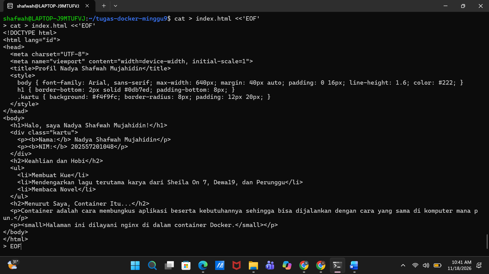
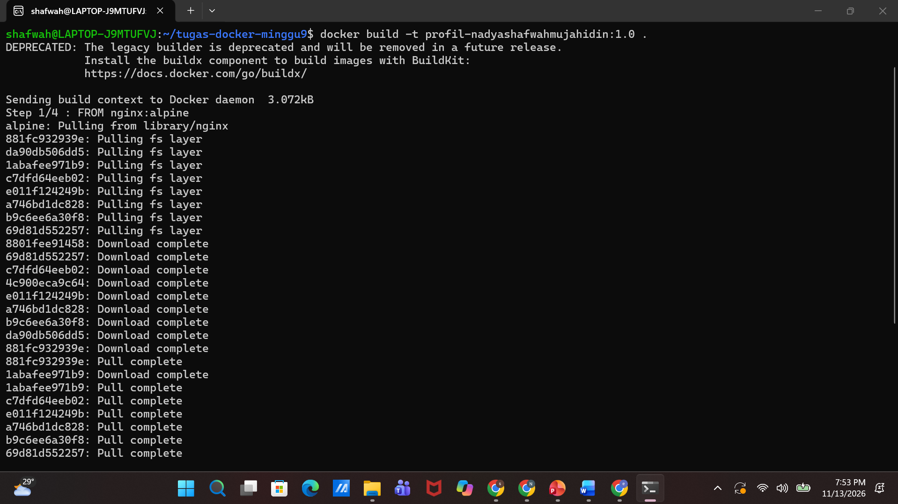
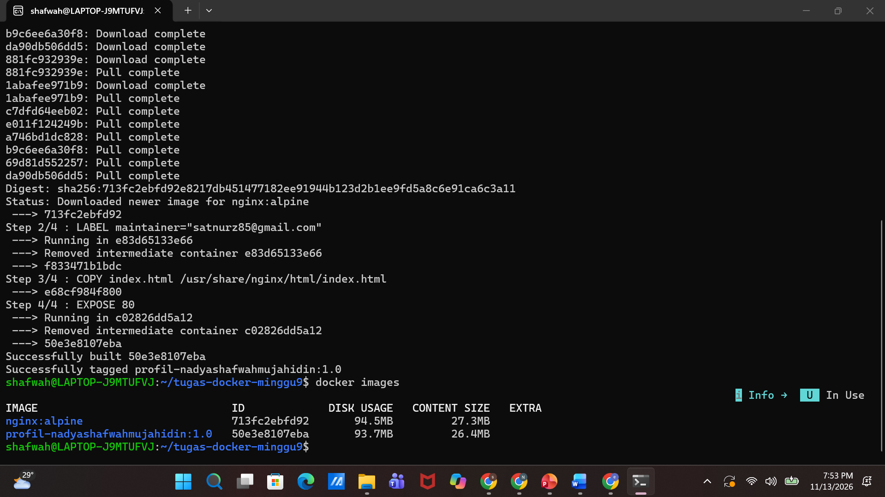
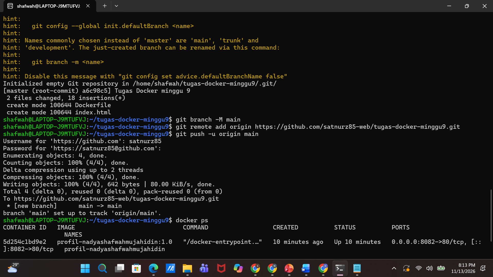
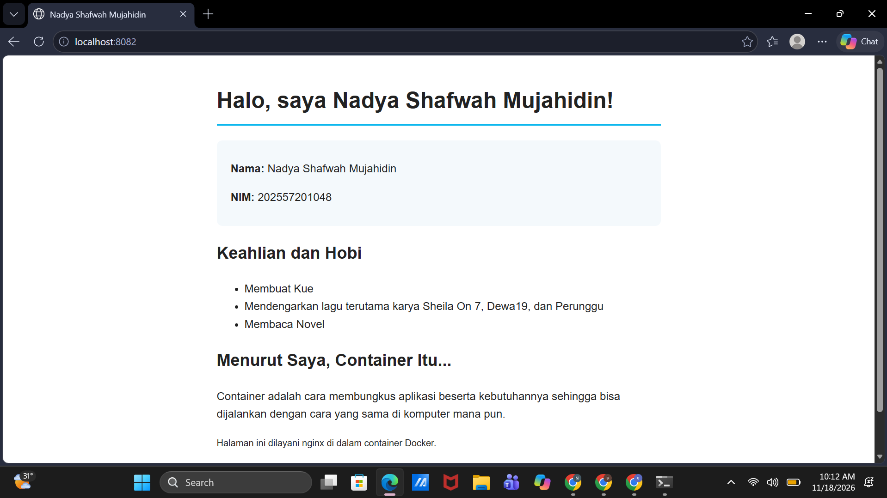
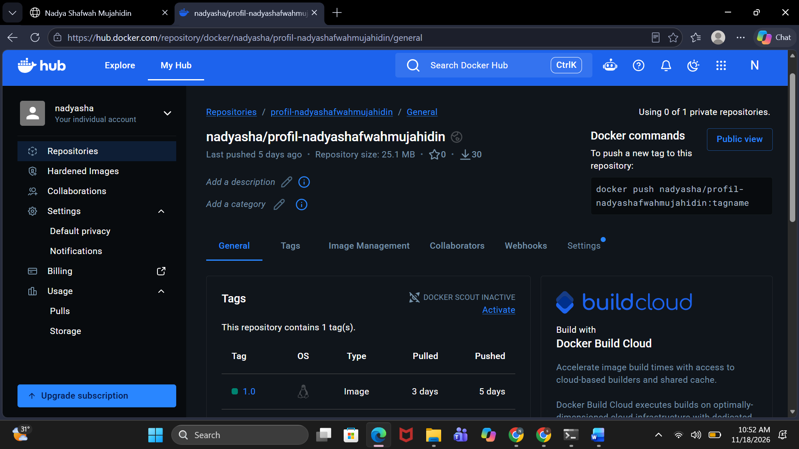
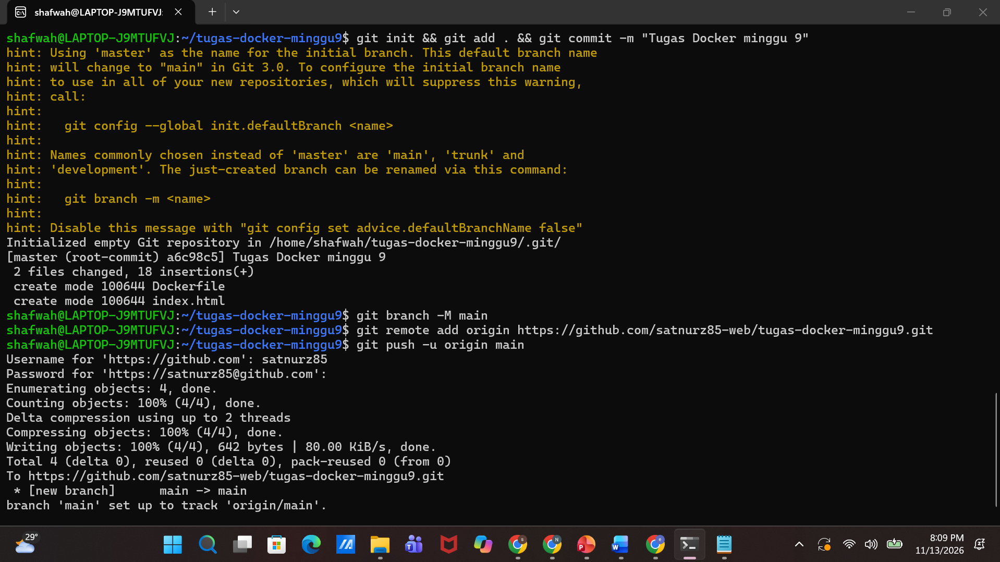
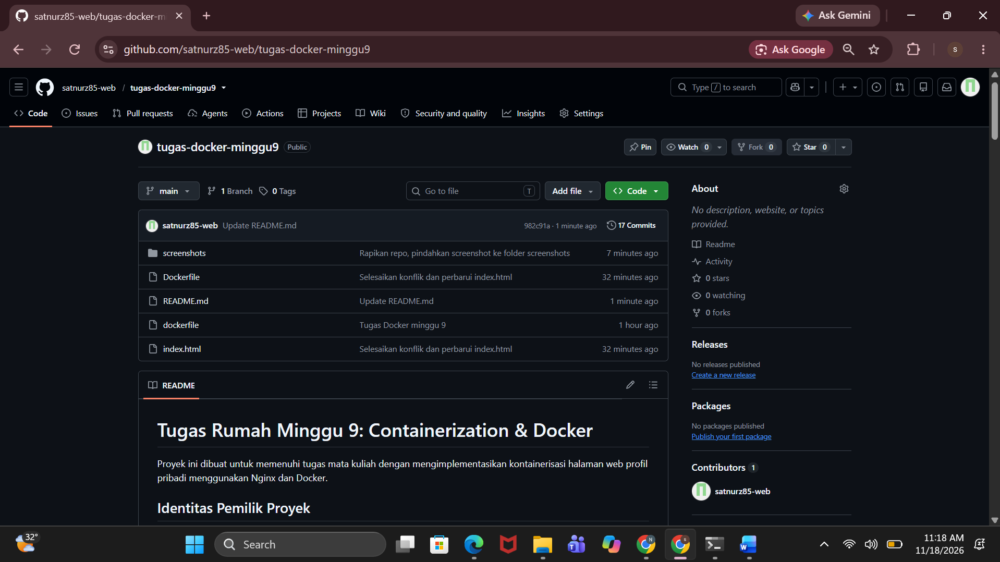

# Tugas Rumah Minggu 9: Containerization & Docker

Proyek ini dibuat untuk memenuhi tugas mata kuliah dengan mengimplementasikan kontainerisasi halaman web profil pribadi menggunakan Nginx dan Docker.

## Identitas Pemilik Proyek
* **Nama:** Nadya Shafwah Mujahidin
* **NIM:** 202557201048

---

## Deskripsi Singkat Proyek
Repositori ini berisi file konfigurasi dasar (*Dockerfile*) dan halaman web statis (*index.html*) yang menampilkan profil pribadi, hobi/keahlian (membuat kue, mendengarkan musik Dewa 19, Sheilaon7, dan Perunggu, serta membaca novel), serta pandangan mengenai teknologi container. Proyek ini dijalankan di atas web server Nginx menggunakan *base image* `nginx:alpine` yang ringan.

---

## Struktur File
* `Dockerfile` : Berisi instruksi otomatis untuk membangun *image* Docker berbasis Nginx.
* `index.html` : Berisi konten halaman web profil pribadi.
* `README.md`  : Dokumentasi penjelasan proyek.

---

## Cara Menjalankan Proyek (Instalasi & Eksekusi)

Ikuti langkah-langkah berikut di terminal Linux/Ubuntu Anda untuk menjalankan container ini secara lokal:

1. **Clone atau unduh repositori ini ke komputer lokal Anda:**
   ```bash
   git clone <url-repositori-anda>
   cd tugas-docker-minggu9

## Cara Menjalankan Proyek

1. **Build Docker Image:**
   Jalankan perintah berikut di folder proyek untuk membuat *image* Docker:
   ```bash
   docker build -t profil-nadyashafwahmujahidin:1.0 .
2. **Jalankan Docker Container:**
   Jalankan container dalam mode latar belakang (*detached*) dengan memetakan port host `8082` ke port container `80`:
   ```bash
   docker run -d --name profil-nadyashafwahmujahidin -p 8082:80 profil-nadyashafwahmujahidin:1.0
3. **Akses di Browser:**
   Buka browser internet (Chrome/Edge/Firefox) dan kunjungi alamat berikut untuk melihat hasil halaman web:
   ```text
   http://localhost:8082

## Hasil

### Isi index.html


### Build Image


### Daftar Image


### Container Berjalan


### Tampilan di Browser (localhost:8082)


### Docker Hub


### Git


### Halaman Repositori Github


### Halaman Repositori GitHub

